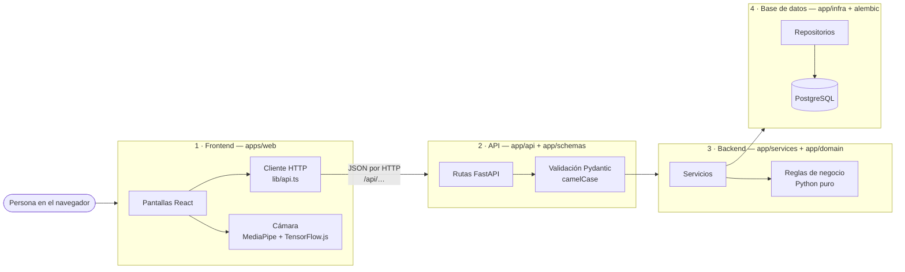

# 🐦 Alas de Señas — Estructura del proyecto (para la sustentación)

El proyecto tiene **4 partes**. No están en 4 carpetas de la raíz porque el kit exige estas rutas (la CI, los hooks y la especificación las usan), pero cada parte vive en su propio lugar y solo se comunica con la siguiente.

Para verlas como 4 carpetas en VS Code: **Archivo → Abrir área de trabajo desde archivo… → `alas-de-senas.code-workspace`**.

## Las 4 partes

| Parte | Carpeta real | Qué hay | Tecnología |
|---|---|---|---|
| **1 · Frontend** | `apps/web` | Pantallas (lecciones, diccionario, cámara, perfil), la cámara con MediaPipe y los modelos de TensorFlow.js | React 19, TypeScript, Vite, Tailwind |
| **2 · API** | `apps/api/app/api` (rutas) · `apps/api/app/schemas` (formatos JSON) | Las direcciones HTTP (`/api/auth`, `/api/lessons`, `/api/reviews`…) y la forma exacta del JSON que entra y sale | FastAPI, Pydantic |
| **3 · Backend** | `apps/api/app/domain` (reglas) · `apps/api/app/services` (servicios) | Las reglas de negocio puras: evaluar respuestas, vidas, XP, racha, logros, repaso espaciado; y los servicios que las coordinan | Python 3.12 (sin FastAPI ni SQLAlchemy en `domain`) |
| **4 · Base de datos** | `apps/api/app/infra` (modelos y repositorios) · `apps/api/alembic` (migraciones) · `docker` | Las tablas, las consultas y la evolución del esquema | PostgreSQL 16 (Docker), SQLAlchemy, Alembic |

Apoyo (no son una de las 4 partes):

| Carpeta | Para qué |
|---|---|
| `content` | Las señas (`signs.csv`), el currículo y los videos de origen |
| `ml` | Entrenamiento de los modelos de la cámara (TensorFlow 2.15, Python 3.11) |
| `docs` | Especificación, decisiones (`DECISIONES.md`) y bitácora (`PROGRESS.md`) |
| `apps/api/tests` | Pruebas del backend, de la API y de la base de datos (pytest) |
| `apps/api/app/core` | Configuración, seguridad (JWT, contraseñas), errores y reloj |
| `apps/api/app/content` | Carga y validación del contenido (`alas content check`) |

## Cómo se comunican

Cada parte solo habla con la siguiente (arquitectura en capas): el frontend nunca toca la base de datos y las reglas de negocio no saben que existe HTTP.

- **Frontend → API:** `apps/web/src/lib/api.ts` envía JSON a `/api/…`. Los tipos de TypeScript se generan desde la API (`uv run alas gen-api` → `apps/web/src/lib/api-types.ts`), así que los dos lados nunca se desalinean.
- **API → Backend:** cada ruta de `app/api` valida el JSON con `app/schemas` y llama a un servicio de `app/services`.
- **Backend:** los servicios usan las reglas de `app/domain` (evaluadores de ejercicios, logros, vidas). Esas reglas son Python puro, con más del 95 % de cobertura de pruebas.
- **Backend → Base de datos:** los servicios leen y guardan con los repositorios de `app/infra/repositories`; las tablas están en `app/infra/models.py` y sus cambios en `apps/api/alembic/versions`.
- **La cámara no pasa por el servidor:** el video se analiza en el navegador y al servidor solo llegan números (qué seña y con qué confianza).

## Ejemplo: responder un ejercicio

1. **Frontend:** la persona elige una opción en la lección → `POST /api/lesson-sessions/{id}/answers`.
2. **API:** `app/api/lessons.py` valida el cuerpo con `app/schemas/lessons.py`.
3. **Backend:** `app/services/lesson_session_service.py` busca el evaluador del tipo de ejercicio (`app/domain/exercises/evaluators.py`) y decide si es correcta, cuántas vidas quedan y cuánta XP gana.
4. **Base de datos:** el repositorio guarda la respuesta en PostgreSQL dentro de una transacción.
5. Vuelve el resultado por el mismo camino y la pantalla muestra «¡Correcto!».

## Comandos (desde la raíz)

| Comando | Qué hace |
|---|---|
| `uv run alas dev` | Enciende el frontend (5173) y la API (8000) |
| `uv run alas db up` | Enciende PostgreSQL en Docker |
| `uv run alas check` | Todas las pruebas y revisiones |
