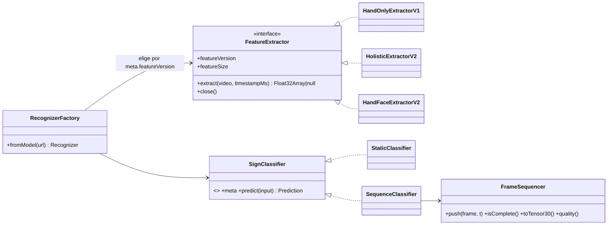

# 🐦 Alas de Señas — Anexo A: Captura de dos manos y rostro (cámara holística)

> **Extiende la §10 de `docs/especificacion.md`** (backend y entrenamiento en Python; navegador en TypeScript). No reemplaza nada de lo existente: el reconocimiento del alfabeto (modelo estático de una mano) sigue funcionando igual.
> **Prioridad:** fase **10B**. Se implementa **después** de la fase 10 y solo si el equipo lo decide; no debe retrasar las fases 0–11.
> Todas las reglas de la §0 de la especificación aplican (pruebas primero, `alas check`, no cambiar decisiones sin documentarlas).

---

## A.0 Qué se tomó del documento de investigación y qué no

| Del documento | Decisión | Motivo |
|---|---|---|
| MediaPipe detecta la geometría; el reconocimiento de LSC lo hace un modelo propio | ✅ Se mantiene | Coincide con la arquitectura actual (D11). |
| **Holistic Landmarker** para manos + cara + cuerpo | ✅ **Se adopta** como extractor principal | Verificado: está disponible en `@mediapipe/tasks-vision` para web; entrega 21 puntos por mano (izquierda y derecha separadas), 33 de pose, 478 de cara y 52 *blendshapes* opcionales. |
| `HandLandmarker` con `num_hands=2` | ✅ Como **alternativa** si Holistic es lento | Holistic asigna cada mano al lado del cuerpo, lo que evita confundir izquierda y derecha. |
| Gesture Recognizer | ❌ Se descarta | Solo clasifica gestos genéricos; personalizarlo exige Python y no usa la cara. |
| Extraer puntos con MediaPipe en Python + OpenCV | ❌ Se descarta | La extracción se hace **solo en el navegador**, con la misma versión de MediaPipe y la misma normalización que usa la app (evita discrepancias entre MediaPipe de Python y de JavaScript). |
| Python para entrenar y evaluar modelos | ✅ **Se adopta** | Python (TensorFlow/Keras) entrena sobre los vectores que exporta el navegador y convierte el modelo a TensorFlow.js (`ml/`). |
| `timestamp_ms += 33` fijo | ❌ Se corrige | En la web los cuadros no llegan a ritmo fijo; se usa `performance.now()` estrictamente creciente y remuestreo temporal (A.4). |
| Separar entrenamiento y prueba **por participante** | ✅ Se mantiene | Ya estaba en la §10.5. |
| Empezar con pocas señas y ampliar | ✅ Se mantiene | 3–5 señas para la primera versión. |
| Datasets públicos (LSC70, LSC50, LSC-54, LeSiCo, SEMILLES, INSOR) | ⚠️ Uso condicionado (A.7) | Sirven para ampliar y evaluar, solo si se re-extraen con el mismo pipeline y se respeta la licencia. |
| Ficha de seña con `fuente_licencia` | ✅ Se adopta | Se agregan `source` y `license` a cada muestra del dataset (A.6). |

---

## A.1 Por qué manos + rostro + cuerpo

En la LSC el significado depende de:
1. **Forma de cada mano** (configuración).
2. **Ubicación** de la mano respecto al cuerpo y la cara (mentón, frente, pecho).
3. **Movimiento** (trayectoria en el tiempo).
4. **Uso de una o dos manos** (dominante y no dominante).
5. **Expresión facial** (cejas, ojos, boca: preguntas, intensidad, negación).

El modelo de una sola mano del alfabeto solo cubre el punto 1. Este anexo cubre los cinco.

---

## A.2 Configuración de MediaPipe

### A.2.1 Extractor principal: `HolisticLandmarker`

```ts
import { FilesetResolver, HolisticLandmarker } from '@mediapipe/tasks-vision';

const fileset = await FilesetResolver.forVisionTasks('/mediapipe/wasm');   // archivos locales, nunca CDN
const holistic = await HolisticLandmarker.createFromOptions(fileset, {
  baseOptions: { modelAssetPath: '/mediapipe/holistic_landmarker.task', delegate: 'GPU' },
  runningMode: 'VIDEO',
  minFaceDetectionConfidence: 0.5,
  minPoseDetectionConfidence: 0.5,
  minHandLandmarksConfidence: 0.5,
  outputFaceBlendshapes: true,          // expresiones faciales (52 valores)
  outputPoseSegmentationMasks: false,   // no se necesita y consume recursos
});
```

- `alas camera-assets` debe descargar también `holistic_landmarker.task` (variante float16) a `apps/web/public/mediapipe/`.
- Si `delegate: 'GPU'` falla al crear el detector, reintentar con `'CPU'` y registrar el aviso.
- **Verificar la versión instalada** de `@mediapipe/tasks-vision` y leer los tipos (`HolisticLandmarkerResult`) antes de usar nombres de campos; no inventarlos.

### A.2.2 Alternativa: `HandLandmarker` + `FaceLandmarker`

Solo si Holistic no alcanza **12 cuadros por segundo** en un portátil de prueba (A.8). Mismo contrato de salida (A.3): el `FeatureExtractor` oculta cuál de los dos se usa. En este modo la ubicación respecto al cuerpo se aproxima con la cara (sin hombros): escala = distancia entre las esquinas externas de los ojos × 2,5.

### A.2.3 Cámara

- `getUserMedia({ video: { width: 640, height: 480, frameRate: { ideal: 30 } }, audio: false })`.
- Procesar a **~15 cuadros por segundo** (saltar cuadros si llegan más rápido).
- Timestamps con `performance.now()`; si no es mayor que el anterior, saltar el cuadro.
- Toda la limpieza de la §10.4 sigue aplicando (detener pistas, `close()`, pausar en pestaña oculta, *singleton*).

---

## A.3 Vector de características por cuadro — versión `holistic-v2`

> Todo se calcula en una sola función pura `buildHolisticFrame(result, options) → Float32Array | null` con pruebas unitarias. **La misma función se usa para recolectar, importar datasets y reconocer (todo en el navegador).** Python nunca recalcula puntos: entrena sobre los vectores ya construidos.

### A.3.1 Sistema de referencia (cuerpo)
- **Origen:** punto medio de los hombros (pose 11 y 12).
- **Escala:** distancia entre hombros. Si es < 1e-6 o falta la pose → el cuadro es **inválido** (`null`).
- Todas las posiciones "respecto al cuerpo" se expresan como `(punto − origen) / escala`.

### A.3.2 Mano dominante y no dominante
- El usuario elige su mano dominante en el perfil (`dominantHand: 'right' | 'left'`, por defecto `right`).
- Si es zurdo, **se refleja todo** (x → −x en el sistema del cuerpo) y se intercambian izquierda/derecha, también en los *blendshapes* (`…Left` ↔ `…Right`). Así un solo modelo sirve para diestros y zurdos.
- Slot 1 = mano dominante; slot 2 = no dominante.

### A.3.3 Contenido del vector

| Bloque | Valores | Detalle |
|---|---|---|
| Forma mano dominante | 63 | 21 puntos `(x,y,z)` relativos a su muñeca, divididos entre la distancia muñeca–punto 9 |
| Posición mano dominante | 3 | Muñeca respecto al cuerpo (A.3.1) |
| Presencia mano dominante | 1 | 1 si se detectó, 0 si no (sus 66 valores van en 0) |
| Forma mano no dominante | 63 | Igual que la dominante |
| Posición mano no dominante | 3 | |
| Presencia mano no dominante | 1 | |
| Mano → cara | 6 | Muñeca dominante y punta del índice dominante (punto 8) respecto a la punta de la nariz (cara, punto 1), divididos entre la escala del cuerpo |
| Expresión facial | 18 | *Blendshapes* seleccionados (A.3.4), valores 0–1 |
| Presencia de cara | 1 | |
| **Total** | **159** | Constante `HOLISTIC_V2_SIZE = 159` (calculada, no escrita a mano) |

### A.3.4 *Blendshapes* usados (marcadores no manuales)

`browDownLeft, browDownRight, browInnerUp, browOuterUpLeft, browOuterUpRight, eyeSquintLeft, eyeSquintRight, eyeWideLeft, eyeWideRight, jawOpen, mouthFunnel, mouthPucker, mouthSmileLeft, mouthSmileRight, mouthFrownLeft, mouthFrownRight, mouthPressLeft, cheekPuff`

- Se buscan **por nombre** (`categoryName`), nunca por posición en el arreglo.
- Si un nombre no existe en la versión instalada, la prueba de arranque falla con un mensaje claro (no se rellena en silencio).
- **No se guardan los 478 puntos de la cara** en ningún dataset: solo estos 18 valores. Reduce el tamaño y, sobre todo, evita almacenar una "huella" del rostro (§A.9).

---

## A.4 Secuencias (señas con movimiento)

- Una muestra = **2,0 s** de cuadros válidos.
- **Remuestreo temporal obligatorio** a **30 cuadros** equiespaciados usando los timestamps reales (interpolación lineal). Los portátiles no entregan un ritmo fijo; sin esto, la misma seña "dura" distinto en cada equipo.
- Huecos: si una mano falta ≤ 3 cuadros seguidos, se interpola; si falta más, se marca ausente (presencia 0).
- **Control de calidad** de cada muestra (si no cumple, se descarta y se avisa):
  - cara presente en ≥ 80 % de los cuadros;
  - mano dominante presente en ≥ 70 % de los cuadros;
  - pose presente en ≥ 90 % de los cuadros.
- Modos de captura:
  1. **Cuenta regresiva** (lecciones y colector): «3, 2, 1… ¡haz la seña!» → se graban 2 s. **Es el único modo de la primera versión.**
  2. **Continuo** (futuro): ventana deslizante con detección de inicio/fin por energía de movimiento de las manos.

---

## A.5 Guía visual durante la captura

- Silueta guía (cabeza y hombros) superpuesta al video: «Ubícate dentro de la silueta».
- Mensajes en vivo (calculados cada 0,5 s):
  - «No veo tu cara» · «No veo tus hombros, aléjate un poco» · «Tus manos salen del cuadro» · «Hay poca luz» (luminancia media del cuadro baja).
- Dibujo superpuesto: esqueleto de las dos manos (colores distintos para dominante y no dominante), puntos de hombros y un contorno simple de cara (no la malla completa).
- El botón «Grabar» se habilita solo cuando cara, hombros y al menos una mano están visibles.

---

## A.6 Formato del dataset `holistic-v2`

```json
{
  "format": "alas-dataset",
  "featureVersion": "holistic-v2",
  "featureSize": 159,
  "frames": 30,
  "durationSec": 2.0,
  "createdWith": { "tasksVision": "<versión instalada>", "app": "<commit>" },
  "samples": [
    {
      "id": "uuid",
      "label": "gracias",
      "collector": "persona-03",
      "dominantHand": "right",
      "source": "propio",
      "license": "propio-con-autorizacion",
      "quality": { "faceRatio": 0.97, "domHandRatio": 0.93, "poseRatio": 1 },
      "data": [[/* 159 números */], /* … 30 cuadros */]
    }
  ]
}
```

Reglas:
- El entrenador (`ml/train_sequence.py`) **rechaza** archivos con otra `featureVersion`, otro `featureSize` u otra versión mayor de `tasksVision` (avisa y no mezcla).
- `collector` es un alias (no el nombre real).
- `source`/`license` son obligatorios; la página de créditos de la app se genera a partir de ellos.

---

## A.7 Datasets externos: cómo usarlos (y cómo no)

> Los datos de esta tabla se verificaron parcialmente el 30/10/2026 (existencia y fuente). **Antes de descargar, confirmar en la página oficial el número de señas, el formato y la licencia.**

| Dataset | Qué aporta | Cómo usarlo en Alas de Señas | Licencia indicada |
|---|---|---|---|
| **LSC70** (Mendeley Data) | Imágenes/secuencias de ~47 señas (alfabeto, números, conversación básica) de muchos participantes | Importar con `/admin/importar`: pasar sus cuadros por `buildHolisticFrame`. Muy útil por la **diversidad de personas**. Si las imágenes son recortes de mano, solo sirven para el modelo estático (sin cara). | CC BY 4.0 (atribución) — verificar |
| **LSC50** (Figshare, 9,9 GB) | Videos de 50 señas + IMU + puntos corporales | Importar los **videos RGB** con el mismo pipeline. Pocas personas: combinar con grabaciones propias. | Verificar en Figshare |
| **LSC-54** (Data in Brief 2025) | Coordenadas 3D de manos, cara y torso extraídas con MediaPipe (22 participantes; colores, cortesía, números) | **Solo con adaptador y prueba de compatibilidad**: confirmar qué solución de MediaPipe y qué índices usaron; recalcular nuestras características desde sus puntos crudos. Si no trae *blendshapes*, el bloque facial va en 0 con `faceFeatures: false`. | CC BY-NC 4.0 (no comercial; válido para uso académico) — verificar |
| **LeSiCo / SEMILLES** (Univ. Nacional) | Vocabulario amplio (~1.980 señas grabadas) | Referencia de vocabulario y variantes; acceso con registro. No se usa para entrenar sin permiso. | Verificar |
| **INSOR Educativo** | Diccionario bilingüe y recursos | Referencia pedagógica y validación. **No descargar en lote ni usar como datos de entrenamiento.** | Ver condiciones de cada recurso |

Reglas de uso:
1. **Nunca** se mezclan coordenadas calculadas por otra herramienta con las nuestras sin pasar por `buildHolisticFrame` o por un adaptador con pruebas.
2. Validar siempre con **personas que no aparezcan** en ningún dataset de entrenamiento (grabaciones propias).
3. Los nombres de las señas externas se mapean a nuestros *slugs* en `content/dataset-mapping.csv` (`fuente,etiqueta_fuente,slug`); las que no estén en el currículo se ignoran.
4. Créditos visibles en `/creditos` con cita de cada dataset usado.

### A.7.1 Importador `/admin/importar` (solo ADMIN)
- Acepta carpeta de imágenes (secuencias ordenadas por nombre) o archivos de video.
- Video: se reproduce en un `<video>` oculto y se procesa con `requestVideoFrameCallback` usando `mediaTime` como timestamp; se remuestrea a 30 cuadros (A.4).
- Imágenes: `runningMode: 'IMAGE'` y un timestamp sintético por cuadro.
- Aplica el control de calidad (A.4) y produce un `dataset.json` `holistic-v2` con `source` y `license` del formulario.
- Procesa por lotes y permite pausar; muestra cuántas muestras se aceptaron y cuántas se descartaron y por qué.

---

## A.8 Modelo de secuencias

- Entrada: `[30, 159]`. Normalización por característica (media y desviación calculadas en el entrenamiento y guardadas en `meta.json`).
- **Entrenamiento en Python** (`ml/train_sequence.py`, TensorFlow 2.15 / Keras 2, mismo entorno `ml/` de la §10.5 de la especificación):
  ```
  uv run --project ml python ml/train_sequence.py --data ml/data/holistic/*.json --out apps/web/public/models/lsc-gestos
  ```
- Arquitectura inicial (Keras):
  `GRU(64, return_sequences=True, reset_after=False)` → `GRU(64, reset_after=False)` → `Dense(64, relu)` → `Dropout(0.3)` → `Dense(n, softmax)` (incluye `NINGUNA`). Se exporta con `tensorflowjs.converters.save_keras_model` y el navegador la carga con `tf.loadLayersModel`.
  > ⚠️ **`reset_after=False` es obligatorio** (verificado el 30/10/2026): con el valor por defecto de Keras (`True`) TensorFlow.js falla al cargar con «GRUCell does not support reset_after parameter set to true» (B73). El harness bloquea un `GRU(` sin ese parámetro en `ml/`, y `ml/fixtures/tfjs-smoke/sequence` es un modelo de prueba con esta misma arquitectura que el navegador ya carga.
- Aumentos de datos (NumPy, solo en entrenamiento): velocidad 0,8–1,2× (remuestreo), rotación ±10° y escala ±10 % de las posiciones, ruido gaussiano pequeño, **reflejo** (con intercambio de mano y *blendshapes* izquierda/derecha).
- **Paridad Python ↔ TypeScript:** las únicas operaciones que existen en ambos lenguajes son el **reflejo** (aumento en Python; zurdos en el navegador) y la **normalización por media/desviación** (`meta.json`). Ambas implementaciones deben pasar los mismos casos de prueba guardados en `ml/fixtures/holistic_v2_cases.json` (entrada → salida esperada), ejecutados por `pytest` y por Vitest. Si un lado cambia, la prueba del otro falla.
- Meta inicial: **3–5 señas** muy distintas + `NINGUNA`; **≥ 60 muestras por seña de ≥ 5 personas** (propias + importadas).
- Aceptación: precisión ≥ 80 % con personas no vistas; matriz de confusión revisada.
- Archivos del modelo: `public/models/lsc-gestos/{model.json, group1-shard*.bin, labels.json, meta.json}` (nombres que genera el conversor; no renombrarlos, B75).
  ```json
  { "featureVersion": "holistic-v2", "featureSize": 159, "frames": 30, "durationSec": 2.0,
    "threshold": 0.7, "mean": [/*159*/], "std": [/*159*/], "labels": ["NINGUNA", "gracias", "hola"] }
  ```

### A.8.1 Rendimiento
- Medir y mostrar en modo ADMIN: cuadros por segundo y ms por inferencia.
- Objetivo: ≥ 12 cuadros por segundo en un portátil de gama media. Si no se alcanza: (1) bajar a 480×360, (2) cambiar al extractor alternativo (A.2.2), (3) desactivar el dibujo de puntos.
- Inferencia del modelo de secuencias **solo al terminar** la ventana de 2 s (no en cada cuadro), dentro de `tf.tidy()`.

---

## A.9 Privacidad y datos sensibles

- El rostro es un dato especialmente sensible (Ley 1581 de 2012). Por eso:
  - El video **nunca** sale del navegador ni se graba.
  - Los datasets guardan solo números: forma de manos, posiciones relativas y 18 valores de expresión. **No** los 478 puntos de la cara ni imágenes.
  - Quien aporte muestras al colector firma una autorización y se identifica con un alias.
- Aviso antes de activar la cámara holística: «Usaremos la cámara para ver tus manos y tu expresión facial. El análisis ocurre en tu computador; no guardamos ni enviamos tu imagen».

---

## A.10 Cambios en la arquitectura (compatibles con lo existente)



- `RecognizerFactory` lee `meta.json` y elige extractor y clasificador. **El modelo del alfabeto (sin `meta.json` o con `featureVersion: "hand-v1"`) sigue funcionando sin cambios.**
- Patrones: **Polimorfismo** y **abierto/cerrado** (nuevos extractores o clasificadores sin tocar la UI), **Fabricación pura** (`buildHolisticFrame`, `FrameSequencer`), **Inversión de dependencias** (la UI depende de interfaces).
- `ProduceActivity` decide: si la seña está en `labels.json` del modelo de gestos → captura con cuenta regresiva de 2 s; si está en el del alfabeto → modo estático; si en ninguno → autoevaluación.
- Retroalimentación opcional de Tomi comparando con el promedio de la seña en el entrenamiento: «La forma de la mano va bien; acerca la mano al mentón» / «Levanta las cejas: es una pregunta».

---

## A.11 Riesgos adicionales de la cámara holística (H1–H11; complementan el catálogo §14)

| # | Riesgo | Prevención | Prueba |
|---|---|---|---|
| H1 | Confundir mano izquierda y derecha entre cuadros | Holistic asigna manos por lado del cuerpo; slots dominante/no dominante | Unit con resultados sintéticos |
| H2 | El modelo falla con zurdos | Reflejo completo + intercambio de *blendshapes* L/R | Unit: reflejo dos veces = original |
| H3 | La misma seña "dura" distinto según el equipo | Remuestreo a 30 cuadros por timestamps | Unit con timestamps irregulares |
| H4 | Nombres de *blendshapes* cambian entre versiones | Búsqueda por nombre + prueba de arranque | Unit |
| H5 | Mezclar datasets de versiones distintas | `featureVersion`, `featureSize` y versión de MediaPipe en cada archivo | Unit del cargador |
| H6 | Coordenadas de otros datasets incompatibles | Re-extracción con el mismo pipeline o adaptador con pruebas | Prueba de compatibilidad por dataset |
| H7 | Portátil lento: < 12 FPS | Medición en vivo y degradación escalonada (A.8.1) | Manual en 2 equipos |
| H8 | Muestras malas (sin cara, manos fuera) contaminan el entrenamiento | Control de calidad por muestra (A.4) | Unit |
| H9 | Guardar datos faciales identificables | Solo 18 *blendshapes*, nunca la malla ni imágenes | Revisión del formato |
| H10 | Uso de datasets sin permiso | `source`/`license` obligatorios y página de créditos | Revisión |
| H11 | El reflejo o la normalización difieren entre Python y TypeScript | Fixtures compartidos `ml/fixtures/holistic_v2_cases.json` probados en ambos lenguajes | pytest + Vitest |

---

## A.12 Pruebas obligatorias (`buildHolisticFrame` y `FrameSequencer`)

- Tamaño del vector = 159 en todos los casos (con y sin manos/cara).
- Invariancia: trasladar o escalar todo el cuerpo no cambia el vector (tolerancia 1e-5).
- Reflejo para zurdos: aplicar dos veces devuelve el original; los *blendshapes* L/R se intercambian.
- Mano ausente: bloque en ceros y presencia 0.
- Pose ausente: devuelve `null`.
- Remuestreo: 23 cuadros con timestamps irregulares → exactamente 30 cuadros, primero y último conservados.
- Interpolación de huecos ≤ 3 cuadros; huecos mayores marcan ausencia.
- Control de calidad: muestras por debajo de los umbrales se rechazan con el motivo correcto.

---

## A.13 Tareas — Grupo 10B (agregar a `tasks.md` después del Grupo 10)

- [ ] **10B.1** `camera:assets` descarga `holistic_landmarker.task`; prueba de arranque que crea el detector (GPU → CPU) y verifica los nombres de *blendshapes*.
- [ ] **10B.2** `buildHolisticFrame` + pruebas A.12. Campo `dominantHand` en el perfil (`PATCH /me`).
- [ ] **10B.3** `FrameSequencer` (remuestreo, huecos, calidad) + pruebas.
- [ ] **10B.4** Interfaces `FeatureExtractor`, `SignClassifier`, `RecognizerFactory`; migrar el alfabeto a `HandOnlyExtractorV1` sin cambiar su comportamiento.
- [ ] **10B.5** Guía visual de captura (silueta, mensajes en vivo, dibujo de manos/hombros/cara) y medición de FPS.
- [ ] **10B.6** Colector `holistic-v2` con cuenta regresiva de 2 s, alias, autorización y exportación.
- [ ] **10B.7** `ml/train_sequence.py` (Python): GRU, aumentos, normalización, separación por persona, matriz de confusión, exportación a TensorFlow.js con `labels.json` y `meta.json`; fixtures de paridad Python ↔ TypeScript.
- [ ] **10B.8** Importador `/admin/importar` (imágenes y videos) + `content/dataset-mapping.csv` + página `/creditos`.
- [ ] **10B.9** `ProduceActivity` con modo gestos; retroalimentación básica de Tomi.
- [ ] **10B.10** Entrenar 3–5 señas con ≥ 5 personas y validar con personas no vistas (≥ 80 %).
  **Verificar:** en 1366×768 y un portátil de gama media, ≥ 12 FPS; la seña entrenada se reconoce con una persona que no grabó; al salir se apaga la cámara.

---

## Fuentes

- Google AI Edge — Holistic Landmarker (descripción y guía web): https://developers.google.com/edge/mediapipe/solutions/vision/holistic_landmarker
- LSC70 — Mendeley Data: https://data.mendeley.com/datasets/9ssyn8tff5
- LSC50 — Figshare: https://figshare.com/articles/dataset/LSC50_Colombian_Sign_Language_Video_and_Inertial_Measurement_Dataset/27383016
- LSC-54 — Universidad de La Sabana (Data in Brief, 2025): https://pure.unisabana.edu.co/en/publications/lsc-54-a-landmark-based-dataset-for-colombian-sign-language/
- LeSiCo — Sign Language Dataset Compendium: https://www.sign-lang.uni-hamburg.de/lr/compendium/lex/lesico.html
