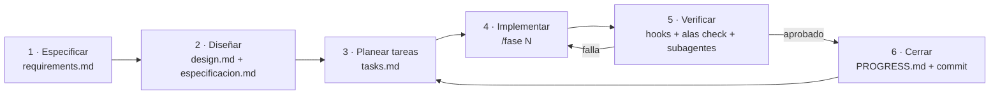
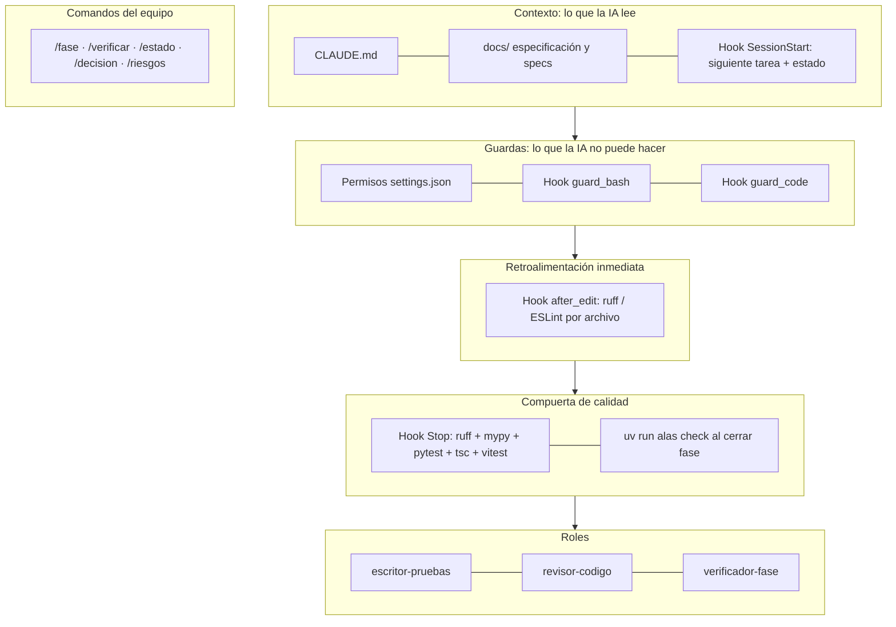

# Spec-Driven Development + Harness — cómo se construye Alas de Señas con IA

> Guía para el equipo y para Claude Code. Explica **el método** (Spec-Driven Development) y **el arnés** (*harness*) que hace que la IA lo siga sin desviarse.

---

## 1. Las dos ideas en una frase

- **Spec-Driven Development (SDD):** primero se escribe *qué* debe hacer el sistema y *cómo* se va a construir; el código se genera después, tarea por tarea, y siempre se verifica contra esa especificación.
- **Harness (arnés):** todo lo que rodea al agente de IA para que trabaje bien: el contexto que lee, las reglas que no puede romper, los controles automáticos que corren mientras trabaja, los comandos para pedirle cosas y los agentes que revisan su trabajo.

Una especificación sin arnés depende de que la IA "se porte bien". Un arnés sin especificación no sabe qué controlar. **Juntos, convierten las reglas del documento en controles que se ejecutan solos.**

---

## 2. El flujo SDD del proyecto



| Paso | Artefacto | Quién lo escribe | Pregunta que responde |
|---|---|---|---|
| 1. Especificar | `docs/specs/requirements.md` | Equipo (ya hecho) | ¿Qué debe hacer el sistema? Criterios EARS verificables. |
| 2. Diseñar | `docs/specs/design.md`, `docs/especificacion.md`, `docs/anexo-camara-holistica.md`, `docs/mockups.md` | Equipo (ya hecho) | ¿Cómo se construye? Capas, datos, API, reglas, riesgos. |
| 3. Planear | `docs/specs/tasks.md` | Equipo (ya hecho) | ¿En qué orden? Tareas pequeñas trazadas a requisitos. |
| 4. Implementar | Código + pruebas | Claude Code | — |
| 5. Verificar | Hooks, `alas check`, subagentes, verificación manual | Arnés + equipo | ¿Cumple los criterios? |
| 6. Cerrar | `docs/PROGRESS.md`, `docs/DECISIONES.md`, commit | Claude Code | ¿Qué quedó y qué se decidió? |

**Trazabilidad:** cada tarea cita sus requisitos (`_R4.4_`), cada requisito tiene criterios EARS y cada criterio debe tener una prueba. El subagente `verificador-fase` revisa esa cadena.

---

## 3. Componentes del arnés



### 3.1 Contexto
| Archivo | Para qué |
|---|---|
| `CLAUDE.md` | Claude Code lo lee automáticamente al iniciar: fuentes de verdad, lenguajes, comandos, reglas y el uso del arnés. |
| `docs/…` | La especificación completa (protegida contra edición). |
| Hook `SessionStart` (`session_start.py`) | Al abrir o reanudar una sesión, agrega al contexto las 3 siguientes tareas pendientes, las últimas notas de `PROGRESS.md` y el estado de git. La IA nunca "olvida" dónde iba. |

### 3.2 Guardas (prevención)
**Permisos** (`.claude/settings.json`):
- **Permitido sin preguntar:** comandos de trabajo normal (`uv run alas …`, `uv run pytest/ruff/mypy`, `npm run …`, `git status/diff/add/commit`, Docker Compose arriba).
- **Pregunta antes:** agregar o quitar dependencias, `alembic downgrade`, `alas db reset`, `alas db seed-demo --reset`, `git push`, `rm`, `docker compose down`, editar `.github/` (CI) o `ml/pyproject.toml` (versiones verificadas).
- **Prohibido:** leer o editar `.env`; editar la especificación, los requisitos, el diseño, los mockups, los videos originales, el propio arnés (`.claude/`), los modelos de prueba `ml/fixtures/`, `docs/plantillas/` y `docs/validacion-interprete.md`; `git push --force`, `git reset --hard`, `git clean`, `pip install`.

**Hook `guard_bash`** (antes de cada comando): bloquea `pip install`, `--no-verify`, `push` forzado, borrados recursivos peligrosos, `DROP/TRUNCATE` manuales, comandos contra la base de datos de producción, `curl … | sh`, excluir pruebas con `--deselect` o `-k "not …"`, y `npm install` fuera de `apps/web`.

**Hook `guard_code`** (antes de escribir un archivo): revisa solo el texto nuevo y bloquea:

| Dónde | Qué bloquea | Regla |
|---|---|---|
| Todo el código | `skip`, `xfail`, `.only`, `xit` en pruebas | Regla 3 |
| `apps/api/app` | `Any`, `type: ignore` sin código y motivo, SQL con f-strings, `shell=True`, `print()` (salvo en la CLI) | §0.1, §11 |
| `apps/api/app/domain` | imports de FastAPI/SQLAlchemy, `datetime.now()`, `round()`, `hash()` | §4, §7.1, §7.2, §6.7 |
| `apps/web/src` | `any`, `@ts-ignore`, `as unknown as`, token en `localStorage`, `console.log` | §0.1, §9.2 |
| `ml/` | `GRU(` sin `reset_after=False` (el modelo no cargaría en el navegador) | §10, anexo A.7, B73 |
| `api-types.ts` | cualquier edición manual (se genera con `alas gen-api`) | §8.4 |

Cuando un hook bloquea, Claude recibe el motivo, la regla y cómo corregirlo; la acción no se ejecuta.

### 3.3 Retroalimentación inmediata
**Hook `after_edit`** (después de cada edición): formatea y revisa *ese archivo* con `ruff format` + `ruff check --fix` (Python) o `eslint --fix` (TypeScript). Si queda algún error, Claude lo ve al instante y lo corrige antes de seguir.

### 3.4 Compuerta de calidad
**Hook `Stop`** (`quality_gate.py`): cuando Claude intenta terminar su turno, revisa lo que cambió:
- Python del backend → `ruff`, `mypy --strict`, pruebas unitarias.
- Frontend → `tsc` y Vitest.
- Esquemas o routers de la API → `alas gen-api --check` (tipos al día).

Si algo falla, **Claude no puede terminar**: recibe los errores y debe corregirlos. Para no entrar en un ciclo infinito, bloquea como máximo 3 veces seguidas. Al cerrar cada grupo se ejecuta además la verificación completa `uv run alas check`.

### 3.5 Roles (subagentes)
| Subagente | Puede escribir | Para qué |
|---|---|---|
| `escritor-pruebas` | Sí (solo pruebas) | Escribe las pruebas **desde la especificación, antes del código**, e incluye los casos obligatorios de §7. |
| `revisor-codigo` | No | Revisa arquitectura, reglas, seguridad y el catálogo de riesgos §14 / H1–H11. |
| `verificador-fase` | No | Comprueba criterio por criterio, con evidencia, que el grupo cumple; **no confía en lo que dijo quien implementó**. Emite APROBADO / NO APROBADO. |

Separar quien implementa de quien verifica evita que la IA "se califique a sí misma".

### 3.6 Comandos del equipo
| Comando | Qué hace |
|---|---|
| `/fase 0` | Implementa el Grupo 0 con el protocolo completo: contexto → plan → pruebas primero → implementación → verificación → cierre → reporte. |
| `/verificar 5` | Corre `alas check` y te da los pasos manuales del Grupo 5 con el resultado esperado. No cambia código. |
| `/estado` | Resumen del avance (grupos, siguiente tarea, pendientes, decisiones, git). |
| `/decision <texto>` | Registra una decisión en `docs/DECISIONES.md` con problema, opciones y consecuencias. |
| `/riesgos [alcance]` | Tabla de riesgos del catálogo: cubierto / no cubierto / no aplica, con evidencia. |

---

## 4. Ciclo de trabajo diario

1. Abrir la carpeta del proyecto en VS Code y abrir Claude Code (lee `CLAUDE.md` y el hook de inicio le da el estado).
2. `/estado` para ver dónde van.
3. `/fase N` para el siguiente grupo. Leer el plan que propone; si algo no cuadra, corregirlo antes de que siga.
4. Aceptar o rechazar los permisos que pida (dependencias nuevas, `git push`, borrados).
5. Al terminar, **hacer ustedes la verificación manual** que indica (es la parte que la IA no puede hacer: mirar la pantalla, probar la cámara).
6. `/verificar N` si quieren la lista detallada; anotar el resultado en `docs/PROGRESS.md`.
7. `git push` (pide confirmación) para que el equipo tenga los cambios.

Mientras tanto, el equipo de contenido graba videos y ejecuta `uv run alas content all` (§18 de la especificación).

---

## 5. Cuando algo sale mal

| Situación | Qué hacer |
|---|---|
| Un hook bloquea algo legítimo | Pedirle a Claude que explique por qué es necesario. Si el equipo está de acuerdo, crear `.claude/settings.local.json` (no se sube a git) con el ajuste puntual, o editar el hook a mano. Registrar la excepción con `/decision`. |
| La compuerta de calidad bloquea 3 veces | Leer el error; normalmente es una prueba que revela un bug real. Pedir: «Explica la causa raíz del fallo y corrígela sin desactivar pruebas». |
| La IA quiere cambiar la especificación | No puede editarla. Que proponga el cambio con `/decision`; si lo aprueban, editen ustedes el documento. |
| La IA se desvía de la tarea | `/estado` y volver a `/fase N`. Si la sesión es muy larga, empezar una nueva: el hook de inicio le devuelve el contexto. |
| Falla un hook por falta de `uv` | Instalar uv (§19.6 de la especificación) y ejecutar `uv python install 3.12`. Los hooks están escritos en Python estándar y se ejecutan con `uv run --no-project python`. |
| Los hooks de formato y calidad no hacen nada | Es normal antes de `uv sync`: si no existe `.venv` se saltan. Usan `uv run --no-sync` para no instalar dependencias dentro del hook. |

---

## 6. Por qué esto evita errores (relación con el catálogo de riesgos)

| Riesgo típico al programar con IA | Control del arnés |
|---|---|
| Inventa requisitos o cambia el diseño | Especificación protegida + `/decision` + `verificador-fase` contra EARS |
| Desactiva pruebas para "terminar" | `guard_code` (skip/xfail/only) + `guard_bash` (`--deselect`, `-k not`) |
| Deja código que no compila o no pasa lint | `after_edit` por archivo + compuerta `Stop` |
| Mete reglas de negocio en el lugar equivocado | `guard_code` en `app/domain` + prueba de arquitectura + `revisor-codigo` |
| Errores sutiles de Python (redondeo, `hash`, zona horaria) | `guard_code` bloquea `round()`, `hash()`, `datetime.now()` en el dominio |
| Tipos del frontend desincronizados con la API | Edición de `api-types.ts` bloqueada + `gen-api --check` en la compuerta |
| Comandos destructivos | Permisos `deny`/`ask` + `guard_bash` |
| Pierde el hilo entre sesiones | Hook `SessionStart` + `PROGRESS.md` + `tasks.md` |
| Entrena un modelo que luego no carga en el navegador | `guard_code` (GRU) + prueba `tfjs-compat` con `ml/fixtures/` desde la fase 0 |
| Algo se rompe y nadie lo nota hasta la demo | CI en GitHub Actions en cada push (`alas check`) |
| Se califica a sí misma | Subagentes de solo lectura para revisar y verificar |

---

## 7. Probar que el arnés funciona (Grupo 0)

Después de instalar uv, en la raíz del proyecto:

```bash
# Debe bloquear (código 2) y explicar el motivo:
echo '{"tool_input":{"command":"pip install requests"}}' | uv run --no-project python .claude/hooks/guard_bash.py; echo "código: $?"
echo '{"tool_input":{"file_path":"apps/api/app/domain/x.py","content":"from datetime import datetime\nx = datetime.now()"}}' | uv run --no-project python .claude/hooks/guard_code.py; echo "código: $?"

# Debe permitir (código 0):
echo '{"tool_input":{"command":"uv run pytest"}}' | uv run --no-project python .claude/hooks/guard_bash.py; echo "código: $?"
```

En Claude Code, el comando `/hooks` muestra los hooks cargados.
