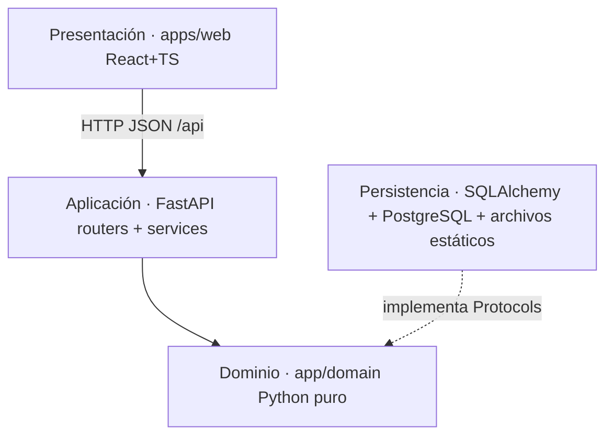
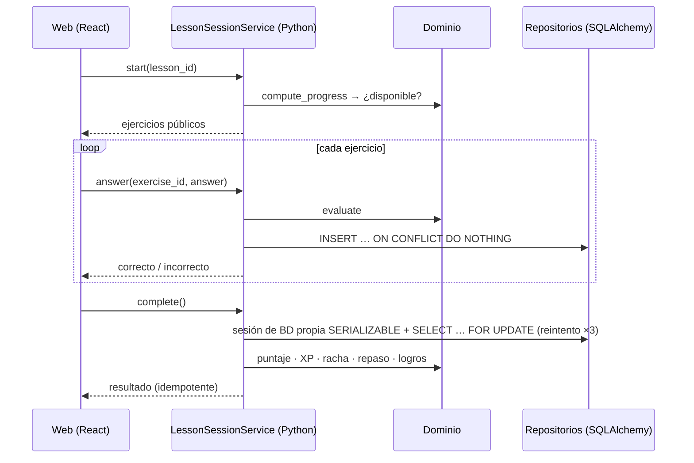

# Diseño — Alas de Señas

> **Spec-Driven Development · documento 2 de 3.** Describe **cómo** se cumplen los requisitos de `requirements.md`.
> Cada sección indica los requisitos que atiende (`→ R4.4` = Requisito 4, criterio 4).
> Versión alineada con la especificación v3.3 (D-002 revisión técnica · D-003 mejoras aprobadas · D-004 plan B de imágenes).
> El detalle completo (modelos SQLAlchemy, listas de contenido, catálogo de riesgos, plantillas) está en `docs/especificacion.md` (v3.3) y la cámara holística en `docs/anexo-camara-holistica.md`.

## 1. Visión general y lenguajes

| Lenguaje | Dónde |
|---|---|
| **Python 3.12** (uv) | API FastAPI, dominio, acceso a datos (SQLAlchemy + Alembic), CLI `alas` (contenido, base de datos, desarrollo), pruebas pytest y E2E con Playwright para Python |
| **Python 3.11** (entorno `ml/`) | Entrenamiento de modelos con TensorFlow 2.15 y exportación a TensorFlow.js |
| **TypeScript** | Solo `apps/web`: React, reproductor de video y cámara (MediaPipe + TensorFlow.js en el navegador) |

- **Un solo origen**: en producción FastAPI sirve la SPA, los videos y `/api`; en desarrollo Vite hace *proxy* de `/api` → `localhost:8000`. → R10.4
- Solo portátil y PC (ancho ≥ 1024 px). → R10.1
- Contrato de la API generado desde Pydantic (`openapi.json` → `api-types.ts`); el frontend no escribe tipos de respuestas a mano.

## 2. Arquitectura en capas

| Capa | Hace | No hace |
|---|---|---|
| Presentación | UI, videos, cámara, llamadas a la API | Calcular XP, puntaje, racha o desbloqueo |
| Aplicación | Validar (Pydantic), autenticar (`Depends`), orquestar, transacciones | Reglas de negocio propias; consultas en routers |
| Dominio | `dataclasses`, `Protocol`s, `Clock` inyectado | Importar `fastapi`/`sqlalchemy`, usar `datetime.now()` |
| Persistencia | Modelos y repositorios SQLAlchemy, archivos | Reglas de negocio |

## 3. Componentes y responsabilidades

| Componente | Responsabilidad | Requisitos |
|---|---|---|
| `api/auth.py` + `AuthService` | Registro, login, refresh rotativo, logout, límite de intentos | R2 |
| `api/curriculum.py` + `CurriculumService` | Ruta con estados derivados por `compute_progress` | R3 |
| `api/lessons.py` + `LessonSessionService` | Sesiones: `start`, `answer`, `complete` idempotente | R4 |
| `GamificationService` | XP, néctar, racha, protector, logros, estadísticas | R5 |
| `ProgressService` · `ReviewService` | Historial, avance, unidades; sesión de repaso evaluada por el servidor (D23) | R6 |
| `HeartsPolicy` (dominio) | Vidas derivadas de `hearts_updated_at` (D24): `current`, `lose_one`, `gain_one`, `refill` | R5.13–5.16 |
| `DemoSeeder` | Usuario de demostración con los servicios reales y reloj simulado | R10.9 |
| `DictionaryService` | Búsqueda normalizada, sugerencias, categorías, favoritos | R7 |
| `RecognitionService` | Resultados numéricos de la cámara | R8 |
| `app/domain` | `score_session`, `RewardPolicy`, `compute_progress`, `StreakPolicy`, `ReviewScheduler`, `evaluate_achievements`, evaluadores de ejercicios, `generate_exercises`, `normalize_text`, fechas locales | R3–R7, R9 |
| `app/content` + CLI `alas content` | Videos de relleno (Pillow + ffmpeg), normalización, validación, seed idempotente | R9 |
| `apps/web/src/camera` | `normalizeLandmarks`, reconocedor, clasificador, suavizado, colector | R8 |
| `ml/` | `train_static.py`, `train_sequence.py`, exportación a TensorFlow.js | R8.7 |

## 4. Modelo de datos (resumen)

**Contenido** (IDs estables, *upsert* con `ON CONFLICT DO UPDATE`): `modules(id "M1", order, published)`, `nodes(id "M1-N2", kind)`, `lessons(id "M1-N2-L3", type)`, `categories`, `signs(id slug, word, normalized_word, meaning, how_to?, usage_example, motion? (letras: static|dynamic), video_path, poster_path, is_placeholder, introduced_in_lesson_id)`, `exercises(id "<lesson>-NN", activity, type, sign_id?, scored, payload JSONB)`.

**Usuario** (solo hechos): `users (hearts, hearts_updated_at, is_demo)`, `refresh_tokens(token_hash)`, `lesson_sessions (hearts_lost)`, `session_answers (PK session_id+exercise_id)`, `review_sessions (items JSONB solo servidor)`, `review_answers (PK session_id+item_id)`, `daily_activity (PK user_id+day; lessons, reviews)`, `streaks(last_active_day "YYYY-MM-DD")`, `sign_reviews`, `achievements`, `user_achievements (PK compuesta)`, `favorites (PK compuesta)`.

Reglas: `order_by` explícito; tiempos en UTC con zona horaria **fijados por el servicio con `Clock`** (D22); días de negocio en hora de Bogotá; claves compuestas contra duplicados (→ R4.6, R5.10); migraciones Alembic revisadas a mano.

## 5. Interfaces (API `/api`)

| Ruta | Requisitos |
|---|---|
| `POST /auth/register`, `/auth/login`, `/auth/refresh`, `/auth/logout`, `GET/PATCH /me` | R1.6, R2 |
| `GET /learning-path`, `GET /nodes/{id}` | R3 |
| `GET /intro` (público) → tarjetas y mini-quiz | R1 |
| `POST /lessons/{id}/sessions` → ejercicios **públicos** con opciones en tokens opacos (sin `correctId` ni slugs) | R3.8, R4.4 |
| `POST /lesson-sessions/{id}/answers` → `{ correct, correctToken, alreadyAnswered }`; 409 si cerrada, 410 si expiró | R4.5, R4.6, R4.10b |
| `POST /lesson-sessions/{id}/complete` → `LessonCompletionResult` (idempotente; 409 `SESSION_INCOMPLETE`) | R4.9, R4.10, R4.10a, R5 |
| `GET /gamification/stats`, `/achievements`, `POST /gamification/streak-freeze` | R5 |
| `GET /progress/summary`, `/history`, `/units`; `GET /reviews/queue`; `POST /reviews/sessions`, `/review-sessions/{id}/answers`, `/review-sessions/{id}/complete` | R6 |
| `POST /gamification/hearts-refill`; `NO_HEARTS` (403) al iniciar L2–L4 sin vidas | R5.13–5.16 |
| `GET /dictionary/signs`, `/signs/{slug}`, `/categories`; `GET/POST/DELETE /dictionary/favorites` | R7 |
| `POST /recognition/results` | R8 |

Errores: `{ statusCode, code, message }` con `AppError` y manejadores globales; los errores de Pydantic se traducen a `VALIDATION_ERROR` con mensajes en español por campo.

## 6. Reglas de negocio (dominio, Python)

| Regla | Definición | Requisitos |
|---|---|---|
| Puntaje | `score = 100 if total == 0 else round_half_up(correct*100, total)`; `passed = correct*100 >= umbral*total` (60, reto 70). **Nunca `round()`** (redondeo bancario). | R3.4 |
| XP | 0 si no aprueba; `base(10|20) + round_half_up(score*5, 100) + (5 si score == 100)`; repetida → `-(-xp // 2)` | R5.1–5.3 |
| Néctar | +5 por lección aprobada; +10 la primera vez que aprueba el reto del nodo | R5.4 |
| Desbloqueo | Orden global de módulos publicados; lección *i* disponible si *i−1* aprobada | R3.2–3.7 |
| Racha | Día local con `zoneinfo("America/Bogota")` (+ `tzdata`); protectores; `display()` no modifica; cuenta lección **o repaso** | R5.5–5.8 |
| Vidas | 5 máx.; −1 por primer error con puntaje en L2–L4; +1 cada 4 h (derivado de `hearts_updated_at`), +1 por repaso ≥ 80 %, recarga por 30 néctar; 0 vidas bloquea iniciar L2–L4, nunca terminar | R5.13–5.16 |
| Repaso | Intervalos `(1,2,4,7,15,30)`; acierto sube fuerza (máx. 5); error la reinicia | R6.4–6.5 |
| Logros | Clases `AchievementRule`; inserción `on_conflict_do_nothing` + `RETURNING` | R5.10 |
| Normalización | `unicodedata` NFD → proteger ñ → quitar marcas `Mn` y signos → colapsar espacios | R7.1 |
| Ejercicios | `random.Random(f"alas:{lesson_id}")` (**nunca `hash()`**); reparto L1 2–3, L2 2–3, L3 resto, L4 todas; ALPHABET por posición (⌈n/3⌉, ⌈(n−a)/2⌉, resto) | R9.8, R9.11 |

**Tokens opacos (D20):** cada opción se envía como `HMAC(secreto, sesión:ejercicio:lado:seña)[:10]`; el servidor los recalcula al evaluar. Los videos usan rutas por contenido (`/media/v/<hash>.mp4`, D19).

**Evaluadores (polimorfismo, clase abstracta `ExerciseEvaluator`):** `OBSERVE` y `PRODUCE` sin puntaje; `SPELLING` (deletreo del alfabeto) compara el token de la palabra; `VIDEO_TO_MEANING` y `MEANING_TO_VIDEO` comparan el token de la opción elegida con el de la correcta; `MEMORY_MATCH` correcto si errores ≤ pares; `CONVERSATION` correcto si todos los turnos son correctos. `to_public()` elimina la respuesta. Payloads validados con modelos Pydantic discriminados. → R4.4, R4.7

## 7. Flujo de una sesión de lección

Duración contada: `min(fin − inicio, 15 min)`. `complete` exige todas las respuestas (409 `SESSION_INCOMPLETE`); sesiones de más de 24 h o con contenido recargado → 410 `SESSION_EXPIRED`. Cada lección tiene ≥ 4 ejercicios con puntaje.

## 8. Interfaz de usuario (React + TypeScript)

- Rutas: `/bienvenida`, `/ingresar`, `/registro`, `/aprender`, `/leccion/:id`, `/repaso`, `/diccionario[/:slug]`, `/camara`, `/progreso`, `/logros`, `/perfil`, `/admin/dataset`.
- Pantalla principal: barra lateral (≈ 240 px) + ruta en zigzag (máx. 720 px) + panel derecho (≈ 320 px).
- Lección: tarjeta `max-w-3xl`, video máx. 360 px de alto, actividades en secuencia, atajos 1–4 y Enter. → R4.13, R4.14
- `SignVideoPlayer`: `muted playsInline preload="metadata"`, `playbackRate` 0,5/1, `play().catch()`, error con reintento, etiqueta «Video en preparación». → R4.3, R4.12
- Tomi: SVG + Framer Motion; respeta `prefers-reduced-motion`. → R5.12
- Vidas: ❤️ N en barra superior, panel derecho y encabezado de lección; modal «Sin vidas» (repasar, recargar, esperar). `/repaso` usa la tarjeta de lección con la actividad 2. → R5.13–5.16, R6.6–6.8
- Sesión: token en memoria; refresh al cargar; renovación *single-flight*. → R2.6, R10.4

## 9. Cámara y entrenamiento

- **Navegador (TypeScript):** `getUserMedia` → MediaPipe HandLandmarker → `normalizeLandmarks` (63 valores) → MLP TensorFlow.js → mayoría en 10 resultados con confianza ≥ 0,70 (clase `NINGUNA`). Colector `/admin/dataset` exporta `dataset.json` con vectores ya normalizados. → R8.1–8.6
- **Python (`ml/`):** `train_static.py` valida los `dataset.json`, separa por persona (`GroupShuffleSplit`), entrena el MLP con semillas fijas, guarda la matriz de confusión y exporta a TensorFlow.js junto con `labels.json` y `meta.json` en el mismo paso. Alternativa en Google Colab. → R8.7
- Python **no recalcula puntos** de MediaPipe: solo entrena con los vectores del navegador (evita discrepancias).
- Extensión holística (dos manos + rostro) en el Anexo A, con fixtures de paridad Python ↔ TypeScript. GRU con `reset_after=False` (obligatorio para TensorFlow.js).
- **Compatibilidad verificada desde la fase 0:** `ml/fixtures/tfjs-smoke/` + prueba Vitest `tfjs-compat` (MLP y GRU convertidos, salida igual a Python con tolerancia 1e-4). → R8.8
- Solo letras `motion = static` en el modelo del alfabeto. → R8.3a

## 10. Contenido

`alas content placeholders` (Pillow + ffmpeg de `imageio-ffmpeg`) → `alas content videos` (`-an`, 720p, H.264 `yuv420p`, `+faststart`, póster; `subprocess.run` sin `shell=True`) → archivos por contenido `media/v/<hash>.mp4` + `media/manifest.json` **versionados en git** (D19) → `alas content check` (`utf-8-sig`, mojibake, slugs, categorías, tamaños de nodo, ≥ 4 ejercicios con puntaje, conversaciones, palabras de deletreo, manifiesto) → `alas db seed` (upsert idempotente; datos de video desde el manifiesto; módulos no publicados sin lecciones). → R9

**Plan B de imágenes (D25):** `raw/` también acepta `slug.jpg` (una postura) o `slug__1.jpg`…`slug__4.jpg` (secuencia). `app/content/images.py` corrige la rotación EXIF, reduce, centra en 1280×720 y genera un clip (3 s fijo o 1,2 s por imagen con fundido de 0,4 s) que entra al mismo pipeline (nombre por contenido, manifiesto con `source: "images"`). Prioridad: video > imágenes > relleno. La interfaz muestra «Secuencia de imágenes» y oculta la velocidad lenta. → R9.12, R9.13

## 11. Seguridad

Refresh token `secrets.token_urlsafe(32)` guardado como SHA-256; cookie `httponly; samesite=lax; secure; path=/api/auth`; rotación. JWT de 15 min con PyJWT (`algorithms=["HS256"]`). `bcrypt` con validación de 8–72 **bytes**. slowapi: login 5/min por IP + correo, registro 10/min por IP, rutas autenticadas por usuario (no por IP). Pydantic con `extra="forbid"`. CSP con `'wasm-unsafe-eval'`. Toda consulta filtra por el `user_id` del token. → R2, R10.4, R10.7

## 12. Estrategia de pruebas

| Nivel | Herramienta | Cubre |
|---|---|---|
| Dominio | pytest (+ cobertura ≥ 95 %) | §6 completo |
| Arquitectura | pytest + `ast` | El dominio no importa `fastapi` ni `sqlalchemy` |
| Contenido | pytest | Validaciones de contenido |
| API | pytest + `TestClient` + BD `alas_test` (tablas de usuario truncadas tras cada prueba) | Auth, sesiones (respuestas ocultas, tokens, primer intento, idempotencia, incompleta, expirada), diccionario |
| Frontend | Vitest + Testing Library | Actividad 2, reproductor con error, cliente API |
| E2E | Playwright para Python (1366×768) | Intro → registro → L1 → celebración → diccionario → recarga |
| Reloj simulado | `FakeClock` en pruebas de API (D22) | Expiración de 24 h, recarga de vidas, usuario de demostración |
| Compatibilidad ML | Vitest + `ml/fixtures/tfjs-smoke` | Modelos de Python cargan en el navegador |
| CI | GitHub Actions | `alas check` + content check en cada push; E2E en `main` |
| Calidad | ruff, mypy `--strict`, ESLint, `tsc` | En `alas check` |

## 13. Decisiones clave

| Decisión | Motivo |
|---|---|
| Python en todo lo que no corre en el navegador | Un solo lenguaje para backend, datos, contenido, ML y pruebas |
| TypeScript solo en el frontend | El navegador no ejecuta Python; la cámara debe procesarse en el dispositivo |
| FastAPI + SQLAlchemy síncrono | Arquitectura en capas clara y sin errores de asincronía |
| Tipos de la API generados desde Pydantic | Una sola fuente de verdad entre Python y TypeScript |
| Un solo origen | Evita CORS y bloqueo de cookies |
| Evaluación en servidor | Evita trampas de XP |
| Desbloqueo derivado + IDs estables | Contenido nuevo no rompe el progreso |
| Videos de relleno | Todo funciona sin videos reales |
| Extracción en navegador, entrenamiento en Python | Misma normalización en datos y uso |
| TensorFlow 2.15 en `ml/` | El conversor a TensorFlow.js falla con Keras 3 |
| Videos por contenido + manifiesto versionado | Sin caché vieja; despliegue completo; URL sin la palabra |
| Tokens opacos en las opciones | La respuesta no se deduce del JSON |
| Sesión SERIALIZABLE propia al completar | El aislamiento solo se fija al inicio de la transacción |
| Tiempos de negocio con `Clock` (D22) | Duraciones coherentes; pruebas de expiración, vidas y demo con reloj simulado |
| Alfabeto en dos nodos, reparto por posición | Lecciones de ≈ 20 ejercicios; soporta CH/LL/RR |
| Columna `motion` en letras | El modelo estático nunca recibe letras con movimiento |
| TF 2.15.1 + tensorflowjs 4.22.0 + `@tensorflow/tfjs` 4.22.0, `GRU(reset_after=False)` | Verificado: conversión y carga con salida idéntica (D-003) |
| CI en GitHub Actions | `alas check` automático en cada push |
| Imágenes convertidas a clip (no un reproductor aparte) | El resto del sistema no cambia; pasar a video después no toca código |
